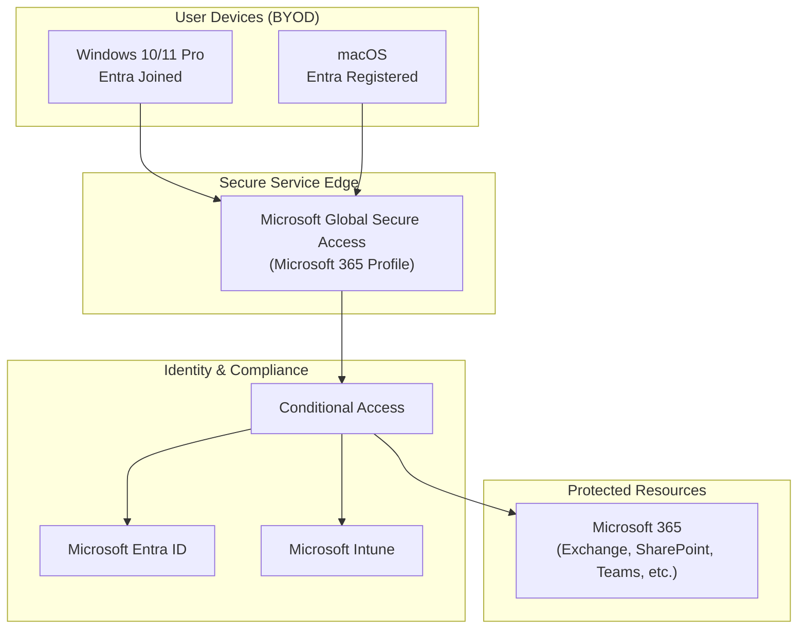

# Secure Service Edge for BYOD using Microsoft Global Secure Access

**Pragmatic Zero Trust network access for a startup under ownership and privacy constraints**

This repository documents the design, implementation, and operationalisation of a Secure Service Edge solution using **Microsoft Global Secure Access (GSA)**, **Microsoft Entra ID**, **Intune**, and **Conditional Access** in a real Bring Your Own Device (BYOD) environment.

The focus was not maximum control; it was **usable security** that respected device ownership while still protecting company resources.

---

## Problem Statement

The organisation needed stronger control over access to Microsoft 365 and internal resources while operating a pure BYOD model (Windows + macOS).

Key tensions:
- Employees used personal devices
- Strong cultural expectation of device ownership and privacy
- Active partnerships requiring multi-tenant Microsoft Teams access
- Limited appetite for heavy-handed device management

A traditional “fully managed device” approach would have failed adoption.

---

## Design Goals

1. Secure access to company Microsoft 365 resources
2. Preserve personal device ownership and privacy as much as possible
3. Support Windows and macOS
4. Enable clean, automated offboarding
5. Make risk trade-offs explicit and defensible

---

## Solution Summary

| Layer | Technology | Scope |
|-------|------------|-------|
| Secure Edge | Microsoft Global Secure Access | Microsoft 365 profile only |
| Identity | Microsoft Entra ID | P1 |
| Device | Intune | User-driven enrollment |
| Enforcement | Conditional Access | Compliant device + GSA + MFA |
| Offboarding | Automated | Retire device → then delete identity |
| Detection | Microsoft Purview + notifications | Data leakage & unauthorised access attempts |

**Key design choice:** Only the Microsoft 365 profile of Global Secure Access was enabled. Private Access and Internet Access profiles were deliberately excluded to protect the ownership/privacy boundary.

---

## High-Level Architecture



---

## Key Architecture Decisions

### 1. Microsoft 365 Profile Only
Private Access and Web/Internet Access were excluded. They would have extended control too far into personal device usage and risked blocking legitimate personal activity.

### 2. Universal Tenant Access Enabled
Required for partnership / multi-tenant Teams collaboration. This expanded the attack surface, but was accepted because the alternative (blocking partner collaboration) was operationally unacceptable. Compensating controls: Conditional Access, MFA, device compliance, and malware response.

### 3. Conditional Access as Primary Enforcement
Security Defaults were disabled so granular Conditional Access policies could be applied. Core signals:
- Device compliance
- Connection via Global Secure Access (verified network)
- MFA (Authenticator)
- Named locations

### 4. Platform-Specific Enrollment
- **Windows**: Full Entra ID join (required for GSA)
- **macOS**: Device registration + Apple Push Notification certificate

### 5. Offboarding Sequence
When an identity is deleted in Entra ID, the automation first retires the device in Intune, then deletes the identity. This reduces residual access risk and cleanly removes the work profile.

---

## Implementation Highlights

**Enrollment**
- User-driven (Settings → Accounts → Access work or school)
- Creates a separate work profile/account on the device
- Enables automated Microsoft 365 app deployment for new joiners
- Activates Microsoft Defender

**Compliance Requirements**
- Windows 10 Pro or higher (Home not supported)
- GSA as a verified network
- MFA satisfied
- Supported macOS version with required extensions

**Production Hardening (actively implemented)**
- QUIC (UDP 443) disabled via Intune Administrative Templates for Edge and Chrome to prevent tunnel bypass
- IPv6 direct routing restricted so M365 traffic stayed on the intended GSA path
- Conditional Access policies first deployed in report-only mode before enforcement
- Break-glass emergency access accounts excluded from strict GSA network requirements
- Offboarding sequence enforced: Intune device retire before Entra identity deletion (avoids management channel race condition)
- Defender risk signals used for immediate session impact on high-severity detections
- Purview and unauthorised-access notifications as supporting detection controls

See [docs/production-hardening.md](docs/production-hardening.md) for full detail.

**Threat Response**
- Malware detection → immediate sign-out and block from resources

**Supporting Controls**
- Microsoft Purview for sensitive information detection
- Notifications on attempted unauthorised access

---

## Challenges & Lessons

| Challenge | How it was handled |
|---------|---------------------|
| Users worried about “device managed by organisation” message | Heavy investment in education and clear communication of what was (and was not) being controlled |
| GSA appearing disabled after configuration | Profile had to be explicitly assigned, easy to miss |
| Teams multi-tenant access broken | Universal tenant access enabled; risk accepted with compensating controls |
| Windows vs macOS complexity | Windows was significantly smoother due to platform familiarity |
| Internet dependency of GSA | Accepted as a limitation; documented for operational awareness |

---

## Outcomes

- Secure access to company resources achieved
- Personal device ownership and privacy largely preserved
- Clean separation of work and personal profiles
- Automated and reliable offboarding path (retire before delete)
- Multi-tenant collaboration remained functional
- Known protocol and network bypasses actively mitigated (QUIC, IPv6)
- Break-glass and report-only practices used to reduce operational risk
- Defensible set of risk trade-offs

---

## Repository Structure

```
├── README.md
├── LINKEDIN-PROJECT-SUMMARY.md
├── docs/
│   ├── architecture-decisions.md
│   ├── device-enrollment.md
│   ├── conditional-access.md
│   ├── offboarding.md
│   ├── production-hardening.md      ← Edge cases & mitigations actually implemented
│   └── lessons-learned.md
└── diagrams/
    └── architecture.mmd
```

---

## Who This Is For

This case study is particularly relevant for:
- Identity & Access Management roles
- GRC / Security Compliance positions
- Zero Trust / SSE implementation roles
- Anyone designing security controls in BYOD or high-autonomy environments

---

## Author

Implemented in a startup environment with real operational and cultural constraints. The design prioritises pragmatic risk reduction and user trust over theoretical completeness.
